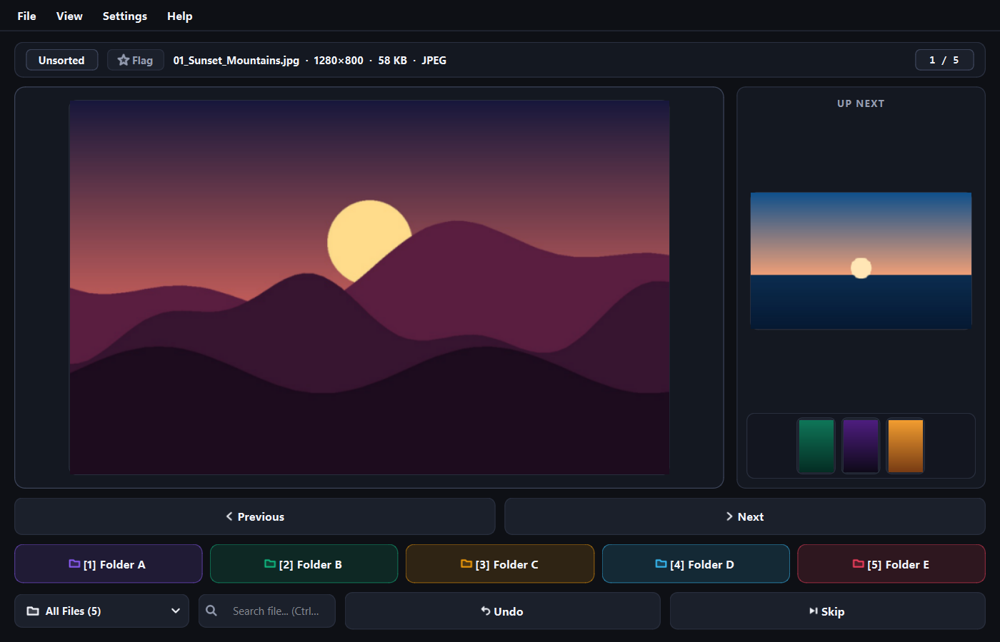
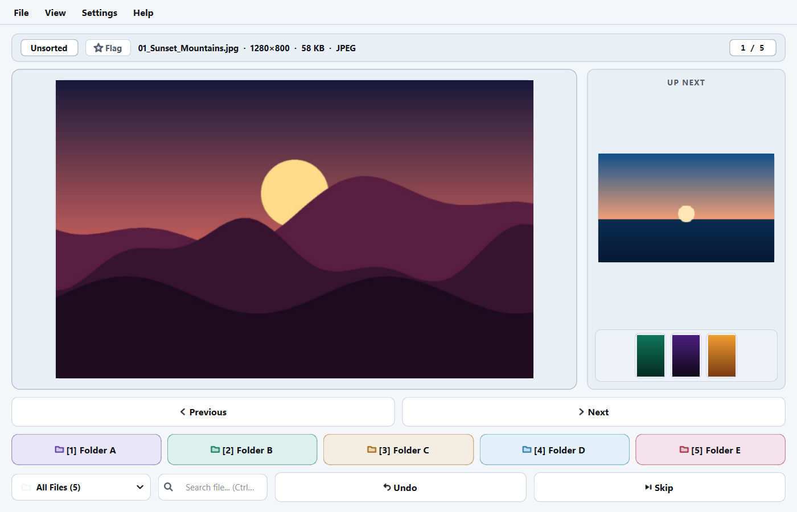

<div align="center">
  
  <h1>Image Sorter</h1>
  <p><strong>Fast, modern desktop media curation and rapid sorting application for images &amp; videos.</strong></p>

  <p>
    <a href="https://github.com/Zy0x/Image-Sorter/blob/main/LICENSE"></a>
    <a href="https://github.com/Zy0x/Image-Sorter/releases/latest"></a>
    <a href="#"></a>
    <a href="#"></a>
    <a href="https://github.com/Zy0x/Image-Sorter/stargazers"></a>
  </p>

  <br />
  
</div>

---

## 📌 Overview

**Image Sorter** is a high-performance desktop media curation and sorting tool built with **PySide6**. Beyond photos and graphic assets, it provides first-class native support for **video files** (`.mp4`, `.webm`, `.mkv`, `.mov`, `.avi`, `.m4v`, `.wmv`) featuring zero-lock playback, synced audio, interactive seeking, and auto-hiding controls.

Designed for speed and reliability, it lets you organize tens of thousands of images and videos into customized destination folders with single-key taps, rapid hold-to-move, real-time search (`Ctrl+F`), and complete zero-overwrite file protection.

---

## ✨ Features

- ⚡ **Rapid Move (`1`–`9`):** Move files to custom folders instantly with keys `1`–`9` or hold the keys/buttons to sort continuously.
- 🔍 **Real-Time Search (`Ctrl+F`):** Instant filename search combined with active category filters.
- 📁 **Smart Filter with Counts:** Categorized filters (`All Files`, `Images`, `Videos`, `GIFs`, `Duplicates`, `Flagged`) showing live file count badges.
- 🎬 **Unified Media Support:** Smooth playback for Videos (`.mp4`, `.mkv`, `.webm`), Animations (`.gif`, `.webp`), and High-Res images (`.heic`, `.png`, `.jpg`, `.psd`).
- 🔎 **Duplicate Finder (`Ctrl+D`):** Perceptual hashing (`dHash`) detects exact and visually similar files across formats.
- 🛡️ **Zero-Overwrite Safety:** Automatic duplicate renaming, full undo history (`Ctrl+Z`), and Recycle Bin integration (`Delete`).
- 🎨 **Adaptive Themes:** Studio Slate Dark, Clean Light, and full custom theme editor.

---

## 📁 Supported Formats

Image Sorter natively scans, decodes, and curates **33 media formats** out-of-the-box:

| Category | Extensions |
|---|---|
| 🎬 **Videos** | `.mp4`, `.webm`, `.mkv`, `.mov`, `.avi`, `.m4v`, `.wmv` |
| 🎞️ **Animations** | `.gif`, `.webp`, `.apng`, `.avif` |
| 🖼️ **Standard Photos** | `.jpg`, `.jpeg`, `.png`, `.jfif`, `.bmp`, `.tiff`, `.tif`, `.ico` |
| 🍏 **Modern & Apple** | `.heic`, `.heif`, `.avif` |
| 🎨 **Design & Vector** | `.psd`, `.svg`, `.svgz`, `.tga`, `.icns`, `.cur`, `.pbm`, `.pgm`, `.ppm`, `.xbm`, `.xpm`, `.wbmp` |

---

## ⌨️ Essential Shortcuts

| Shortcut | Action |
|---|---|
| `1` – `9` (Press / Hold) | Move / Rapid Move to Folder Slot |
| `←` / `→` (Press / Hold) | Previous / Next media item |
| `Space` | Skip current file |
| `Ctrl + F` | Focus search bar (instant filename filter) |
| `F` or Double-Click | Full-Size / Zoom Preview dialog |
| `P` / `M` | Video Play/Pause & Mute toggle |
| `Ctrl + Z` | Undo last move operation |
| `Ctrl + H` | Toggle Hide Moved files |
| `Ctrl + O` | Open / Import folder |
| `F1` | Open full Keyboard Shortcuts guide |

---

## 🚀 Quick Start

### 1. Run from Source
```bash
git clone https://github.com/Zy0x/Image-Sorter.git
cd Image-Sorter
run.bat
```

*(Or manually with Python: `pip install -r requirements.txt` then `python main.py`)*

### 2. Standalone Installer (Windows)
Download the latest executable installer or portable build from [GitHub Releases](https://github.com/Zy0x/Image-Sorter/releases/latest).

---

## 📷 Screenshots

| Studio Dark | Clean Light |
| :---: | :---: |
|  |  |

---

## 📦 Project Links

- [Changelog](CHANGELOG.md) — Release notes and update history.
- [Roadmap](ROADMAP.md) — Feature tracker and upcoming plans.
- [License](LICENSE) — MIT License.

---

<div align="center">
  <sub>Developed by <b><a href="https://github.com/Zy0x">Zy0x</a></b> • Built with Python & PySide6</sub>
</div>
