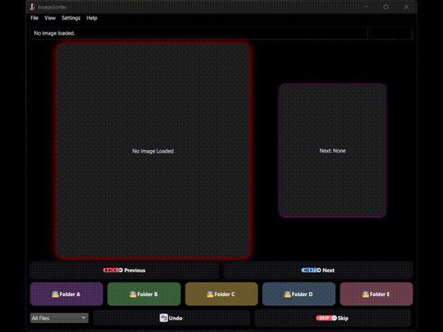

<div align="center">
  <h1 style="display: inline-flex; align-items: center; justify-content: center; gap: 10px;">
    
    Image Sorter
  </h1>
</div>

<div align="center">
  <strong>A fast, modern desktop image sorting application with Rapid Move, 100,000+ file background scanning, drag &amp; drop, undo protection, and customizable themes.</strong>
</div>

<br />

<div align="center">
  <!-- Badges -->
  <a href="https://github.com/Zy0x/Image-Sorter/blob/main/LICENSE"></a>
  <a href="https://github.com/Zy0x/Image-Sorter/releases/latest"></a>
  <a href="#"></a>
  <a href="#"></a>
  <a href="https://github.com/Zy0x/Image-Sorter/stargazers"></a>
</div>

<br />

<div align="center">
  
</div>

---

## 📌 Description

**Image Sorter** is a modern desktop application built with **PySide6** that lets you organize thousands—or hundreds of thousands—of images into custom folders with a single keystroke or mouse click. Featuring **Rapid Move** (hold-to-sort), zero-overwrite file protection, background directory scanning (`os.scandir`), EXIF auto-orientation, animated GIF/WebP playback, full-size zoom preview, and customizable themes, it is built for speed and reliability.

---

## ✨ Key Features

> * **One-Key & Rapid Move (`1`–`5`)** – Press keys `1`–`5` (or click Folder A–E) to move an image, or **hold** keys `1`–`5` / buttons A–E to sort continuously at your configured interval (50–1000 ms).
> * **100,000+ File Engine** – Single-pass `os.scandir` background thread with natural filename sorting (`IMG_2` before `IMG_10`) and $O(1)$ move/undo operations.
> * **Zero-Overwrite File Safety** – Automatically renames duplicate filenames (`photo (1).jpg`, `photo (2).jpg`) and protects original paths during Undo (`Ctrl+Z`).
> * **Full-Size & Zoom Preview (`F`)** – Double-click the main image or press `F` to inspect details with Zoom In/Out, Fit, 100%, and mouse-wheel zoom.
> * **Animated GIF / WebP & High-MP Support** – Plays animations from an in-memory buffer (never locking files on Windows), applies EXIF auto-rotation, and uses scaled decoding for 12–50 MP photos.
> * **Fast Navigation & Filtering** – Filter by extension, toggle **Hide Moved Images (`Ctrl+H`)**, jump to any image number (`Ctrl+G`), or jump to start/end (`Home` / `End`).
> * **Recycle Bin & Explorer Integration** – Move unwanted images to the Windows Recycle Bin (`Delete`) or reveal the current file in Explorer (`Ctrl+E`).
> * **Built-In Shortcuts Guide (`F1`)** – On-button shortcut badges (`[1]`–`[5]`), empty-state quick-start guide, and a complete `Help → Keyboard Shortcuts & Guide` dialog.

---

## ⌨️ Keyboard Shortcuts

| Shortcut | Action |
|---|---|
| `1` – `5` (Press) | Move current image to Folder A – E |
| `1` – `5` (Hold) | **Rapid Move** continuously to Folder A – E |
| `←` (Left Arrow) | Previous image |
| `→` (Right Arrow) | Next image |
| `Space` | Skip to next **unmoved** image |
| `Home` / `End` | Jump to first / last image |
| `Ctrl+G` | Jump to specific image number |
| `Ctrl+H` | Toggle **Hide Moved Images** |
| `F` or Double-Click | Open Full-Size / Zoom Preview |
| `Ctrl+Z` | Undo last move |
| `Ctrl+E` | Show current image in File Explorer |
| `Delete` | Move current image to Windows Recycle Bin |
| `Ctrl+O` | Import folder |
| `F1` | Open Keyboard Shortcuts & Quick Guide |

---

## 🔧 Requirements

Ensure you have Python >= 3.8 installed. Install dependencies using:

```bash
pip install -r requirements.txt
```

---

## 🚀 Getting Started

### ✅ Option 1: Download & Install (Windows)

1. Visit the [GitHub Releases](https://github.com/Zy0x/Image-Sorter/releases/latest) page.
2. Download the latest `.exe` installer.
3. Run the installer and choose between:
   - **Standard Installation**: Installs to `Program Files` with desktop/Start Menu shortcuts (configuration automatically stored in `%LOCALAPPDATA%\ImageSorter\config`).
   - **Portable Mode (`--portable`)**: Keeps all settings and logs inside the application folder — ideal for USB drives.

### 💻 Option 2: Run from Source

```bash
git clone https://github.com/Zy0x/Image-Sorter.git
cd Image-Sorter
run.bat
```
*(Or manually: `pip install -r requirements.txt` then `python main.py`)*

---

## 🎨 Themes & Customization

Switch between **Light Mode**, **Dark Mode**, **System Default**, or **Custom Theme** (customizable background, text, button, hover, border, and glow colors).

## 📦 Documentation

- [CHANGELOG.md](CHANGELOG.md) — Release history and changes.
- [ROADMAP.md](ROADMAP.md) — Completed milestones and future roadmap.

## 🌐 License

MIT License — see [LICENSE](LICENSE) for details.

## 👤 Author

👤 **Zy0x**

- GitHub: [@Zy0x](https://github.com/Zy0x)
- Telegram: [@Thea](https://t.me/ThuandMuda)

## 📷 Screenshots

| Light Mode | Dark Mode |
|------------|-----------|
|  |  |

---

> ⚡ Organize your photos in seconds — effortlessly.  
> **Made with ❤️ using Python & PySide6**
